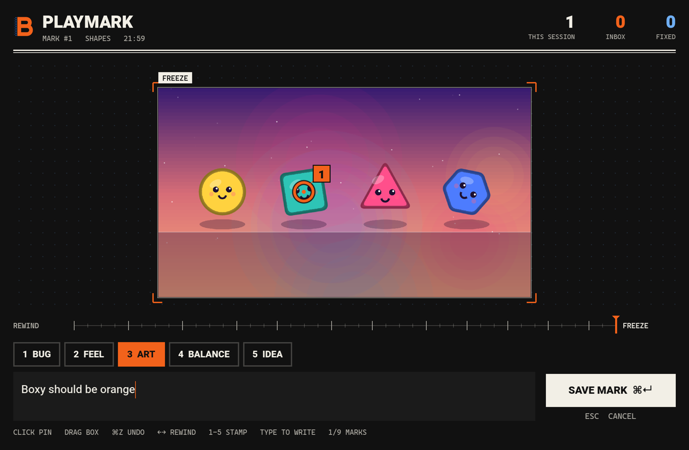
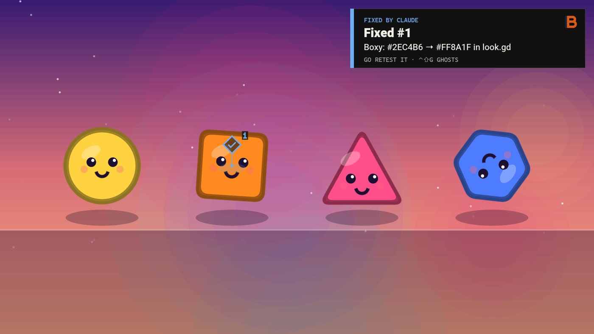
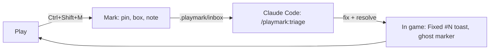

<div align="center">


# Playmark

**Mark what you see while playing your Godot game. Claude Code fixes it.**

[](https://github.com/barmoshe/playmark/actions/workflows/ci.yml)


[](LICENSE)

[Site](https://playmark.bar-builds.com) · [Install](#quick-start) · [How a mark looks](#what-a-mark-contains) · [Changelog](CHANGELOG.md)

</div>

Playtesting your own game, you notice things you'd rather not stop and write up: a jump that
feels floaty, a color that reads wrong, an error in the log. Playmark is a Godot addon and a
Claude Code plugin. Press <kbd>Ctrl</kbd>+<kbd>Shift</kbd>+<kbd>M</kbd>, the game freezes, you
pin what you mean and write a line. Claude Code gets the frame, the last seconds of play, the
log, and the node under your pin, and fixes it. Back in the game, a toast says "Fixed".

<p align="center">
  
</p>

<p align="center">
  
</p>

## How it works



1. **Mark.** The game pauses on the current frame. Click to pin, drag to box, press
   <kbd>1</kbd>-<kbd>5</kbd> for a category (bug, feel, art, balance, idea), type the note.
   Missed the moment? <kbd>←</kbd> rewinds up to 5 seconds.
2. **Claude reads it.** The next prompt in Claude Code mentions the new mark.
   `/playmark:triage` looks at the frame, finds the code from the nodes under your pins,
   proposes a fix per mark, and fixes the ones you approve.
3. **You retest.** The running game polls for Claude's status: "On #3 now", then "Fixed #3"
   with what changed. A ghost marker stays where you made the mark, so you can walk back and check.

## Features

- **Photo mode for feedback.** A native window over the game, sharp at any game resolution, pixel art included.
- **Rewind.** The last 5 seconds are kept at 8 fps. Mark the frame where it happened.
- **The code under your pin.** Each mark lists the colliders, nodes, scripts and UI controls under every pin and box.
- **Ghosts.** Past marks reappear in the world where you made them. Orange is open, blue is fixed.
- **Errors mark themselves.** A script error becomes a bug mark with the clip and the log, three per session at most.
- **Warp back.** `inbox.mjs warp 3` opens the game at mark #3; `--shot out.png` saves a frame so Claude can check its fix.
- **Hebrew and other right-to-left notes** render correctly.
- **Dev builds only** by default. Nothing runs in a release export unless you turn it on.

## Quick start

Needs Godot 4.5 or newer, Claude Code, and Node 18 or newer.

In Claude Code:

```
/plugin marketplace add barmoshe/playmark
/plugin install playmark@playmark
```

Then, from your game's repo:

```
/playmark:install
```

That copies `addons/playmark` into the project, enables it, and adds `.playmark/` to
`.gitignore`. Run the game from Godot and press <kbd>Ctrl</kbd>+<kbd>Shift</kbd>+<kbd>M</kbd>.

<details>
<summary>Without Claude Code</summary>

Copy `addons/playmark` into your project and enable **Playmark** in Project Settings,
Plugins. Marks still land in `.playmark/inbox/`, readable by any tool or person.

</details>

## Using it in a game

Everything is optional. Without any of it, marks still carry the frame, the clip, the log and
the nodes under each mark.

```gdscript
# State saved with every mark.
Playmark.add_context("player", func(): return {"hp": hp, "wand": wand.describe()})

# Ghosts open their note when the player walks up to them (the mouse otherwise).
Playmark.set_player($Player)

# Many rooms in one scene: keep each ghost in its room.
Playmark.set_scope(func(): return "room/%s" % room_id)

# Warp: what to save with a mark, and how to put the game back there.
Playmark.set_warp(
    func(): return {"args": ["--level=%d" % level], "player": [position.x, position.y]},
    func(d): position = Vector2(d.player[0], d.player[1]))

# Open the overlay from a debug button.
Playmark.open()
```

A node in the group `playmark_context` with a `_playmark_context() -> Dictionary` method is
saved with every mark too.

## Keys

| Key | Where | Does |
|---|---|---|
| <kbd>Ctrl</kbd>+<kbd>Shift</kbd>+<kbd>M</kbd> | game | open the overlay |
| <kbd>Ctrl</kbd>+<kbd>Shift</kbd>+<kbd>G</kbd> | game | show or hide ghosts |
| click / drag / right-click | overlay | pin / box / undo |
| <kbd>1</kbd>-<kbd>5</kbd> | overlay | bug, feel, art, balance, idea |
| <kbd>←</kbd> <kbd>→</kbd> | overlay | rewind |
| <kbd>⌘</kbd>/<kbd>Ctrl</kbd>+<kbd>Enter</kbd> | overlay | save |
| <kbd>Esc</kbd> | overlay | cancel |

## Settings

Project Settings, under `playmark/`:

| Setting | Default | |
|---|---|---|
| `general/enabled` | `true` | |
| `general/shortcut` | `Ctrl+Shift+M` | modifiers: Ctrl, Shift, Alt, Cmd |
| `general/release_builds` | `false` | also run in release exports |
| `capture/clip_seconds` | `5.0` | |
| `capture/clip_fps` | `8` | `0` turns the clip off |
| `capture/clip_max_width` | `640` | clip frames are scaled down to this |
| `capture/log_lines` | `200` | |
| `capture/auto_on_error` | `true` | script errors become bug marks |
| `ghosts/visible` | `true` | |
| `ghosts/shortcut` | `Ctrl+Shift+G` | |
| `ghosts/fixed_hours` | `72` | how long fixed marks stay visible; `-1` forever |
| `output/dir` | `res://.playmark` | exported builds use `user://playmark` |

## What a mark contains

`<project>/.playmark/inbox/<id>/`, moved to `done/` once fixed:

| File | |
|---|---|
| `annotated.png` | the frame with numbered pins and boxes |
| `clip_sheet.png` | up to 12 frames from the last seconds, oldest first |
| `clip/` | every clip frame (`inbox.mjs video <id>` makes an mp4 with ffmpeg) |
| `screenshot.png` | the clean frame |
| `log.txt` | the last lines Godot printed, warnings and errors included |
| `mark.json` | note, category, marks, scene, nodes under each mark, your context, warp data |

Marks are git-ignored by default. Claude Code works with them through
`scripts/inbox.mjs`: `list`, `show`, `claim`, `resolve`, `reopen`, `video`, `warp`. Marks are
addressed by number (`3`, `#3`) or id.

## Platforms

Desktop: tested on macOS with Godot 4.6 and 4.7. Windows and Linux should work and are
untested so far. iOS, Android and the web export print "coming soon" and stay off for now.

## Development

```bash
node --test tests/*.test.mjs                                  # the Claude Code side
godot --headless --path demo --script "$PWD/tests/unit.gd"    # the addon, no window
tests/run_selftest.sh                                         # the whole loop, in a window
```

`demo/` is a small Godot project (a toy scene with four shapes, and an arena the selftest
uses) with the addon linked in.

## License

MIT, by [Bar Moshe](https://bar-builds.com). Heebo and Cascadia Mono, bundled in
`addons/playmark/fonts/`, are under the SIL Open Font License (`OFL.txt` there).
