<div align="center">

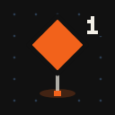

# Playmark

**Mark what you see while playing your Godot or Unity game. Claude Code or Codex fixes it.**

[](https://github.com/barmoshe/playmark/actions/workflows/ci.yml)


[](LICENSE)

[Watch](#watch-it-work) · [Quick start](#quick-start) · [No agent](#no-agent-mark-export-share) · [What a mark holds](#what-a-mark-contains) · [Unity](unity/README.md) · [Cocos](cocos/README.md) · [Changelog](CHANGELOG.md)

<br>

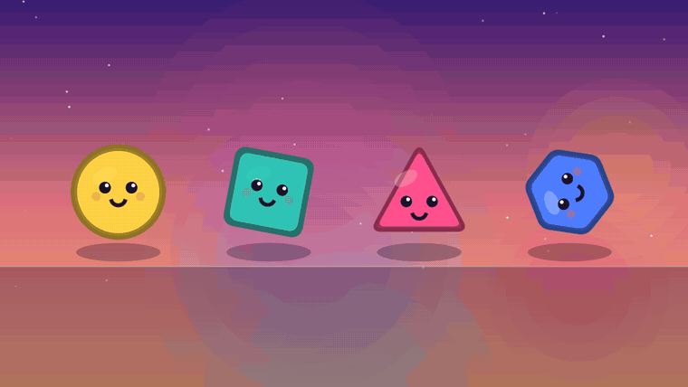

</div>

<br>

Playtesting your own game, you notice small things you'd rather not stop and write up.
Playmark is a Godot addon and a Unity package, plus a plugin for Claude Code and Codex, for exactly
that moment. Press <kbd>Ctrl</kbd>+<kbd>Shift</kbd>+<kbd>M</kbd>: the game freezes, you pin what you
mean and write one line. Your agent gets the frame, the last five seconds, the log and the code
under your pin, and fixes it. Back in the game, a toast says "Fixed" and a marker stays where you left the note.

## Watch it work

Three short films, narrated and captioned. Click a frame to play it; each also comes in Hebrew. A 45 s [montage across all three games](https://playmark.bar-builds.com/media/montage.mp4) (English) is good for sharing.

<table>
<tr>
<td align="center" width="33%"><a href="https://playmark.bar-builds.com/media/watch-color.mp4">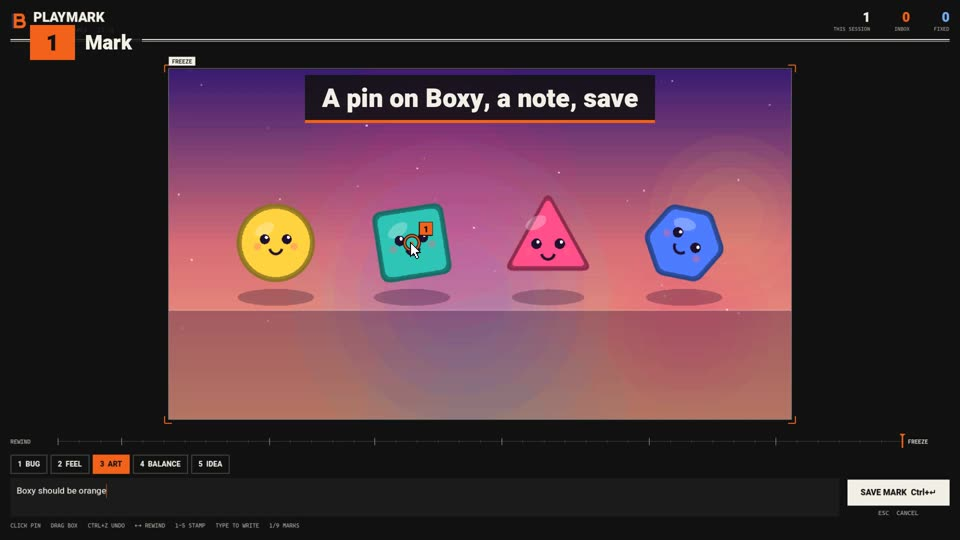</a><br><b>The loop in 16 s</b><br><sub>Mark a shape, Claude fixes it, retest.<br><a href="https://playmark.bar-builds.com/media/watch-color.mp4">English</a> · <a href="https://playmark.bar-builds.com/media/watch-color-he.mp4">עברית</a></sub></td>
<td align="center" width="33%"><a href="https://playmark.bar-builds.com/media/watch-thornback.mp4">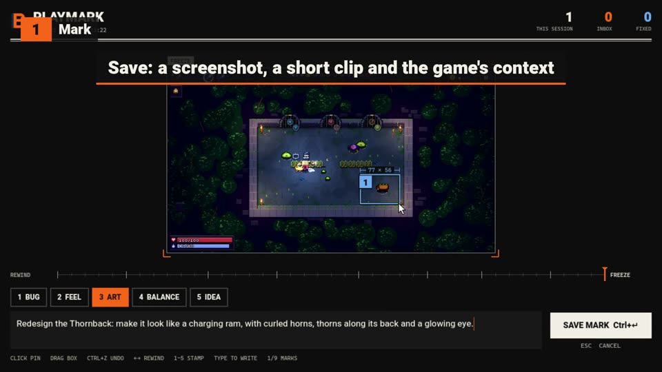</a><br><b>Redesigning an enemy, 23 s</b><br><sub>The Thornback from Wandcraft, one mark.<br><a href="https://playmark.bar-builds.com/media/watch-thornback.mp4">English</a> · <a href="https://playmark.bar-builds.com/media/watch-thornback-he.mp4">עברית</a></sub></td>
<td align="center" width="33%"><a href="https://playmark.bar-builds.com/media/star-dodger.mp4">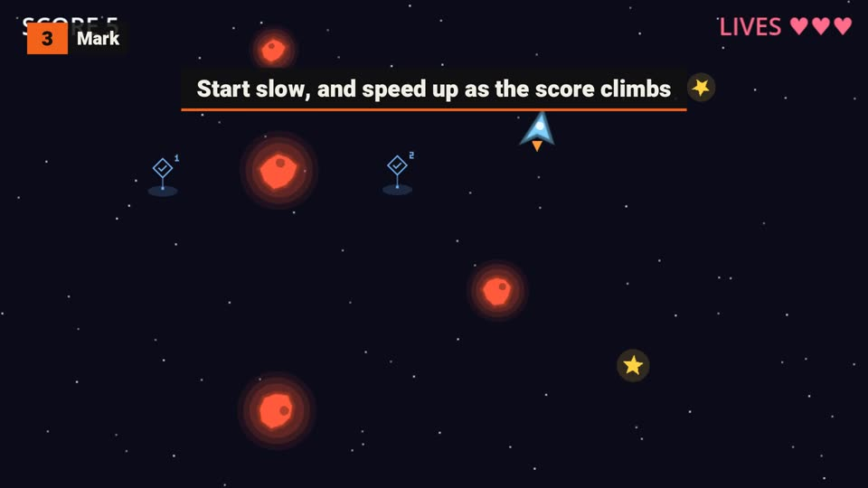</a><br><b>A game built by marking, 55 s</b><br><sub>Star Dodger: blank project, four marks.<br><a href="https://playmark.bar-builds.com/media/star-dodger.mp4">English</a> · <a href="https://playmark.bar-builds.com/media/star-dodger-he.mp4">עברית</a></sub></td>
</tr>
</table>

## How it works

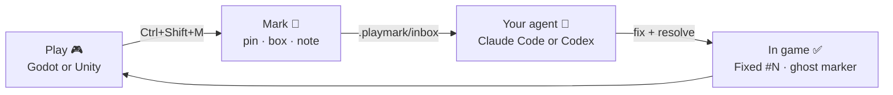

<table>
<tr>
<td width="25%" valign="top"><b>1. Play</b><br>Run your game from Godot or Unity. Playmark keeps the last five seconds.</td>
<td width="25%" valign="top"><b>2. Mark</b><br><kbd>Ctrl</kbd>+<kbd>Shift</kbd>+<kbd>M</kbd> freezes the frame. Click to pin, drag to box, <kbd>1</kbd>-<kbd>5</kbd> for a category, type the note.</td>
<td width="25%" valign="top"><b>3. The agent fixes</b><br>It reads the frame, finds the code under the pin and proposes a fix. You pick.</td>
<td width="25%" valign="top"><b>4. Retest</b><br>The game shows "Fixed #N" with what changed. The marker stays where you made it.</td>
</tr>
</table>

## A real example: redesigning an enemy

[Wandcraft](https://github.com/barmoshe/wandcraft) is a pixel-art roguelite. Its Thornback,
an enemy that charges at you, looked like a loaf of bread. One mark, mid-fight:

<p align="center">
  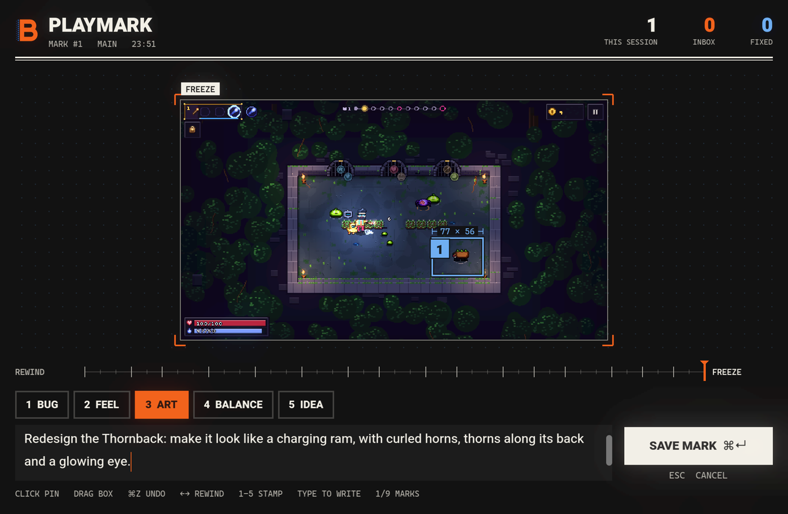
</p>

> **Redesign the Thornback: make it look like a charging ram, with curled horns, thorns along its back and a glowing eye.**

The box told Claude which node it was (`enemy.gd`, kind `ram`), the art lives as 16 rows of
pixel data in `bestiary.gd`, and the game's palette rules came with the project. The redraw:

<p align="center">
  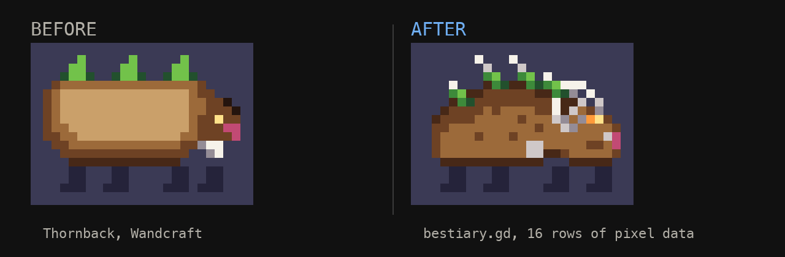
</p>

<p align="center">
  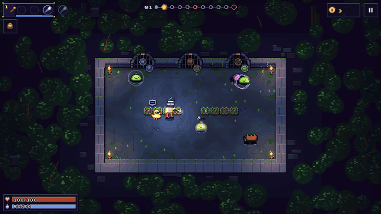
</p>

## Small changes, same flow

<table>
<tr>
<td align="center" width="33%"><br><sub><b>Color</b><br>"Boxy should be orange."</sub></td>
<td align="center" width="33%"><br><sub><b>Shape</b><br>"Redesign Pointy: make it a five-point star."</sub></td>
<td align="center" width="33%">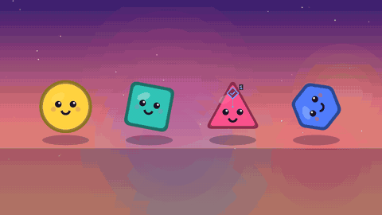<br><sub><b>Motion</b><br>"Make Nutty hop instead of spinning."</sub></td>
</tr>
</table>

Each was one line in the toy scene's `look.gd`. The toy is in [`demo/`](demo).

## What it does

| | |
|---|---|
| **Photo mode for feedback** | A native window over the game, sharp at any game resolution, pixel art included. |
| **Rewind** | The last five seconds are kept. Press <kbd>←</kbd> and mark the frame where it happened. |
| **The code under your pin** | Each mark lists the colliders, nodes, scripts and UI controls under every pin and box. |
| **Ghosts** | Past marks reappear in the world where you made them. Orange is open, blue is fixed. |
| **Errors mark themselves** | A script error becomes a bug mark with the clip and the log. |
| **Warp back** | `inbox.mjs warp 3` opens the game at mark #3; `--shot` saves a frame so the agent can check its fix. |
| **Your game's state** | One line adds the player, the level or the loadout to every mark. |
| **Share without AI** | `inbox.mjs export` turns the marks into one page anyone can open. |
| **Dev builds only** | Nothing runs in a release export unless you turn it on. |

## Quick start

Needs Godot 4.5+, Unity 6+ or Cocos Creator 3.8+, Node 18+, and Claude Code or Codex.

<table>
<tr><th width="50%">Claude Code</th><th width="50%">Codex</th></tr>
<tr>
<td valign="top">

```
/plugin marketplace add barmoshe/playmark
/plugin install playmark@playmark
/playmark:install
```

New marks show up in your next prompt. `/playmark:triage` works through them.

</td>
<td valign="top">

```
codex plugin marketplace add barmoshe/playmark
codex plugin add playmark@playmark
```

In a new session in your game's repo: "Install Playmark in this game", then later "Use playmark to triage my marks".

</td>
</tr>
</table>

Then play and press <kbd>Ctrl</kbd>+<kbd>Shift</kbd>+<kbd>M</kbd>:

| | Godot 4.5+ | Unity 6+ (beta) | Cocos Creator 3.8+ (beta) |
|---|---|---|---|
| Install puts | `addons/playmark`, enabled | the package in `Packages/com.bar-builds.playmark` | `assets/playmark/playmark.ts` |
| You play in | the game run from Godot | Play Mode | a debug web build or the browser preview, with `scripts/sink.mjs` running |
| More | [below](#using-it-in-a-game) | [unity/README.md](unity/README.md) | [cocos/README.md](cocos/README.md) |

All three git-ignore `.playmark/`. `inbox.mjs smoke` checks a Godot or Unity install by itself: it plays 6 s, marks,
saves and stops. Update with `claude plugin update playmark` or `codex plugin add playmark@playmark`.

### Or start a new game with it

Claude Code: `/playmark:new star-dodger --name "Star Dodger"`. Codex: "Start a new Playmark game in
star-dodger".

A blank Godot project with Playmark wired in: one playable scene (a square you move in an empty
room), an `AGENTS.md` that teaches the build, playtest, mark, fix loop (`CLAUDE.md` imports it),
and a first commit. Say what game to build, play each step, mark what's off.

[Star Dodger](https://github.com/barmoshe/star-dodger) was built this way: a blank project, step 1,
then four marks while playing, one commit each. Watch it on
[playmark.bar-builds.com](https://playmark.bar-builds.com/#new) (55 s, with sound).

### No agent? Mark, export, share

Playmark works without any AI. Marks are plain files, and one command turns them into a page
you can open in a browser or send to a teammate.

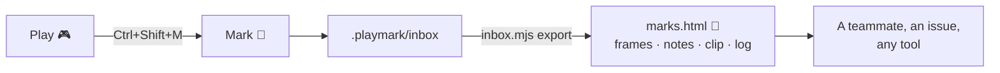

1. **Install by hand.** Godot: copy `addons/playmark` into your project and enable **Playmark** in
   Project Settings, Plugins. Unity: add the package by git URL ([how](unity/README.md#install)).
   Or let the installer do either: `node playmark/scripts/install.mjs <your game>`.
2. **Play and mark** as usual.
3. **Export**, from your game's folder:

   ```bash
   git clone https://github.com/barmoshe/playmark
   node playmark/scripts/inbox.mjs export          # .playmark/export/marks.html
   node playmark/scripts/inbox.mjs export --all    # fixed marks too
   ```

   One HTML file, images inside it: every mark's frame with its pins, the note, the code under each
   pin, the last seconds of play and the log. `inbox.mjs list` and `resolve` work by hand too.

<p align="center">
  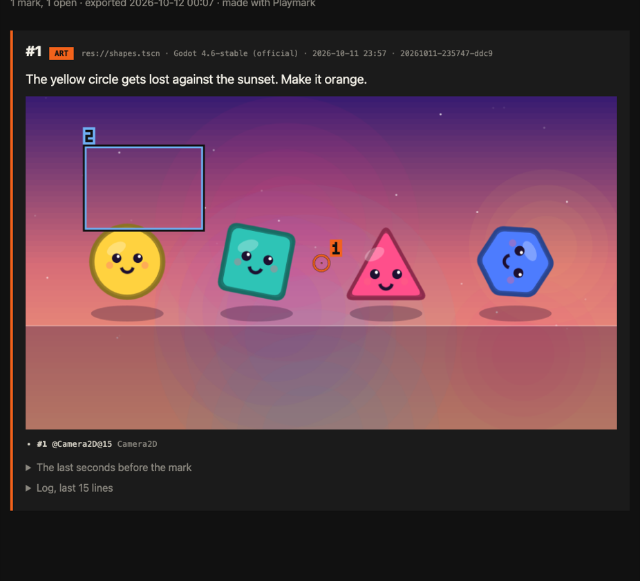
</p>

## What a mark contains

`<project>/.playmark/inbox/<id>/`, moved to `done/` once fixed. Git-ignored by default.

| File | |
|---|---|
| `annotated.png` | the frame with numbered pins and boxes |
| `clip_sheet.png` | up to 12 frames from the last seconds, oldest first |
| `clip/` | every clip frame (`inbox.mjs video <id>` makes an mp4) |
| `screenshot.png` | the clean frame |
| `log.txt` | the last lines the game logged (Godot output or the Unity Console), warnings and errors included |
| `mark.json` | note, category, marks, scene, the nodes under each mark, your context, warp data |

<details>
<summary>mark.json from the Thornback mark (trimmed)</summary>

<br>

```json
{
  "seq": 1,
  "category": "art",
  "note": "Redesign the Thornback: make it look like a charging ram, with curled horns, thorns along its back and a glowing eye.",
  "marks": [{ "type": "box", "number": 1 }],
  "scene": { "path": "res://scenes/main.tscn" },
  "scope": "fight/s_thorns",
  "under_marks": [{ "mark": 1, "nodes": [{ "class": "Node2D", "script": "res://scripts/world/enemy.gd" }] }],
  "context": { "run": { "seed": 3, "step": 1, "room": "fight/s_thorns", "hp": "100/100" } },
  "warp": { "data": { "args": ["--seed=3", "--step=1", "--kind=fight", "--room=s_thorns"] } }
}
```

</details>

## Using it in a game

All optional. Without any of it, marks still carry the frame, the clip, the log and the nodes under each mark.

```gdscript
# State saved with every mark.
Playmark.add_context("player", func(): return {"hp": hp, "wand": wand.describe()})

# Ghosts open their note when the player walks up to them (the mouse otherwise).
Playmark.set_player($Player)

# Many rooms in one scene: keep each ghost in its room.
Playmark.set_scope(func(): return "room/%s" % room_id)

# Warp: what to save with a mark, and how to put the game back there.
Playmark.set_warp(
    func(): return {"args": ["--level=%d" % level], "player": [position.x, position.y]},
    func(d): position = Vector2(d.player[0], d.player[1]))

# Open the overlay from a debug button.
Playmark.open()
```

<details>
<summary>Keys</summary>

<br>

| Key | Where | Does |
|---|---|---|
| <kbd>Ctrl</kbd>+<kbd>Shift</kbd>+<kbd>M</kbd> | game | open the overlay |
| <kbd>Ctrl</kbd>+<kbd>Shift</kbd>+<kbd>G</kbd> | game | show or hide ghosts (Unity: <kbd>J</kbd>) |
| click / drag / right-click | overlay | pin / box / undo |
| <kbd>1</kbd>-<kbd>5</kbd> | overlay | bug, feel, art, balance, idea |
| <kbd>←</kbd> <kbd>→</kbd> | overlay | rewind |
| <kbd>⌘</kbd>/<kbd>Ctrl</kbd>+<kbd>Enter</kbd> | overlay | save |
| <kbd>Esc</kbd> | overlay | cancel |

</details>

<details>
<summary>Settings</summary>

<br>

Project Settings, under `playmark/`:

| Setting | Default | |
|---|---|---|
| `general/enabled` | `true` | |
| `general/shortcut` | `Ctrl+Shift+M` | modifiers: Ctrl, Shift, Alt, Cmd |
| `general/release_builds` | `false` | also run in release exports |
| `capture/clip_seconds` | `5.0` | |
| `capture/clip_fps` | `8` | `0` turns the clip off |
| `capture/clip_max_width` | `640` | clip frames are scaled down to this |
| `capture/log_lines` | `200` | |
| `capture/auto_on_error` | `true` | script errors become bug marks |
| `ghosts/visible` | `true` | |
| `ghosts/shortcut` | `Ctrl+Shift+G` | |
| `ghosts/fixed_hours` | `72` | how long fixed marks stay visible; `-1` forever |
| `output/dir` | `res://.playmark` | exported builds use `user://playmark` |

</details>

## Platforms

| | Status |
|---|---|
| **Godot** 4.5+, desktop | Tested on macOS with 4.6 and 4.7; CI checks 4.5 and 4.7 on Linux. Windows should work, untested. |
| **Unity** 6+, desktop | Beta: checked in 6000.3 LTS on a Mac. See [unity/README.md](unity/README.md#tested). |
| **Cocos Creator** 3.8+, web | Beta: checked with 3.8.8 web-mobile debug builds in Chrome on Windows. See [cocos/README.md](cocos/README.md#tested). |
| **Claude Code** | The plugin: skill, commands, a new-marks notice on each prompt. |
| **Codex** | The same skill and helpers; ask for triage yourself (no notice). |
| **No agent** | Install by hand, `inbox.mjs export` for a shareable page. |
| iOS, Android, web | Prints "coming soon" and stays off. |

## Development

```bash
node --test tests/*.test.mjs                                  # the agent side: inbox, installer, notice
godot --headless --path demo --script "$PWD/tests/unit.gd"    # the addon, no window
tests/run_selftest.sh                                         # the whole loop, in a window
dotnet test unity/core-tests/Tests                            # the Unity package's engine-free core
node unity/check/compile.mjs                                  # the Unity package against Unity's DLLs
node cocos/check/typecheck.mjs <cocos project>                # the Cocos package against Cocos' own typings
```

`demo/` holds the toy scene (four shapes, one table of looks) and the arena the selftest uses.
`film/capture.gd` drives the game under Godot's movie writer; every GIF here was recorded with it.
`film/showcase/` holds the scripts that record the three showcase videos, their edit lists (English and
Hebrew, rendered by `film/cut`); renders land in `film/showcase/videos/` (git-ignored) and the
finished videos are served by the site, to keep the plugin download small.

## License

MIT, by Bar Moshe. Heebo and Cascadia Mono, bundled in `addons/playmark/fonts/`, are under
the SIL Open Font License (`OFL.txt` there).

Privacy: Playmark collects nothing and makes no network calls; marks stay in your game folder
([PRIVACY.md](PRIVACY.md)).

## Website

The site (EN + `/he`) lives in [`site/`](site/): plain HTML, no build step. Vercel serves it with the project's root directory set to `site`; `.github/workflows/site.yml` checks it on every change.

---

Built by [Bar Moshe](https://bar-builds.com/?src=gh-playmark)
